# PC EXPOSED

**Expose your PC. Discover its personality, uncover its secrets, and roast your hardware.**

PC EXPOSED is a free, open-source Windows desktop app. It investigates your PC **locally and read-only**,
scores it with explainable, evidence-based rules, gives it a personality, writes a roast based on what it
really found, and exports share-ready image cards. Nothing is uploaded. Ever.

> **Beta (`v0.2.0-beta.1`).** Everything below works and is tested, but see [Known limitations](#known-limitations).
> New in this release: the **Glow-Up Plan**, opt-in **scan history**, and **Copy specs**
> ([release notes](docs/releases/v0.2.0-beta.1.md)).

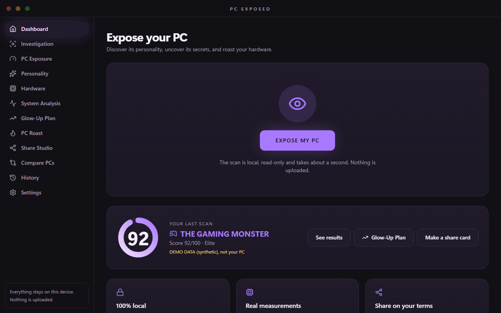

*Screenshots in this README use clearly labelled **synthetic demo data**, not a real machine.*

## What it does

| | |
|---|---|
| 🔍 **Investigates** | CPU, GPU, RAM, storage, OS, startup apps, installed-app count, battery, network adapters and top processes. Read-only, **no administrator rights**. |
| 📊 **Scores honestly** | Six 0–100 scores (Hardware, Memory, Storage, Startup, Configuration, Gaming Readiness), each with reasons, a confidence level and a caveat. Missing data is *Unavailable*, never zero. |
| 🧭 **Separates evidence** | Bottleneck findings are kept apart as *measured*, *potential*, *hardware pairing* and *insufficient evidence*. It never claims a benchmark it didn't run. |
| 🎭 **Assigns a personality** | 12 personalities (THE GAMING MONSTER, THE SLEEPING GIANT, THE CHAOS ENGINE…) chosen from real findings, with the rule shown. |
| 📈 **Glow-Up Plan** | Concrete fixes and upgrades ranked by how many points they would add, with steps. Projections re-run the same scoring rules, so they never disagree with your score. |
| 🔥 **Roasts your PC** | 101 original, conditional lines. A Discord joke only appears if Discord really starts with Windows. No repeats. |
| 🎁 **PC Wrapped** | A story-style recap of your PC. |
| 🖼️ **Share cards** | 5 templates × 2 sizes (1080×1350, 1920×1080), live preview, **Privacy mode**, optional watermark, saved by you. |
| ⚖️ **Compare PCs** | Save scans locally, import a friend's exported report, compare two systems, export a comparison card. |
| 🕒 **History** (opt-in) | Off by default. When on, keeps a summary of each scan on this device and charts your score over time. |
| 📋 **Copy specs** | A plain-text spec sheet for forum posts and "what should I upgrade?" threads. |

### Glow-Up Plan and History

<p>
  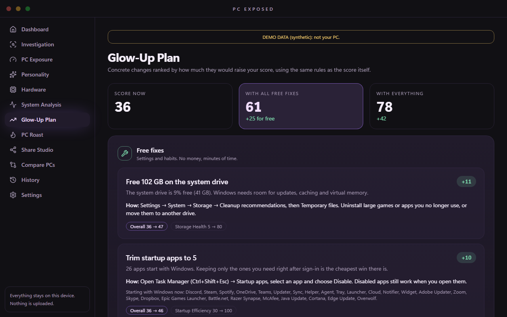
  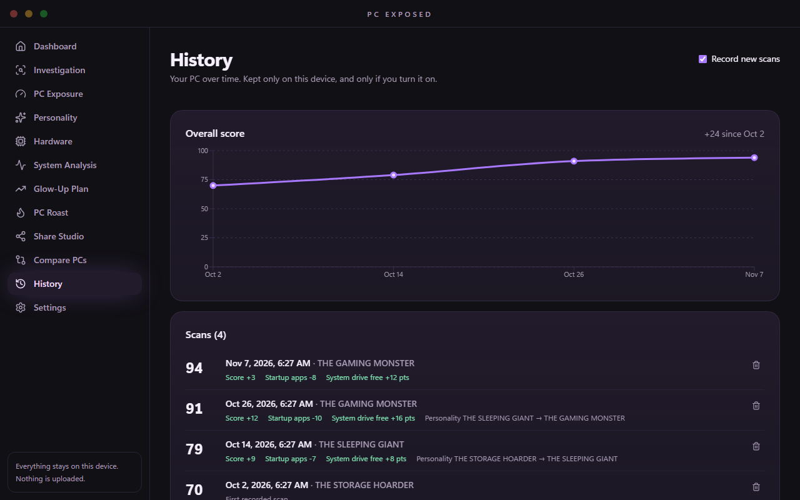
</p>

<p>
  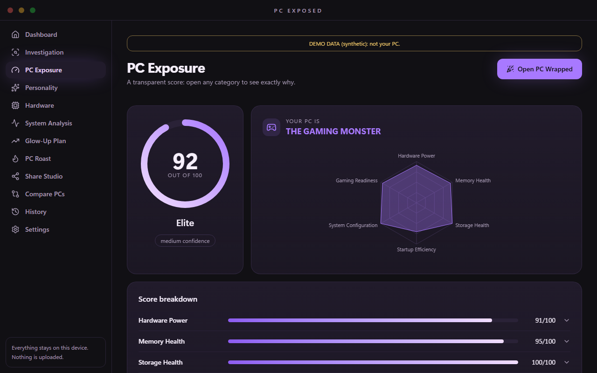
  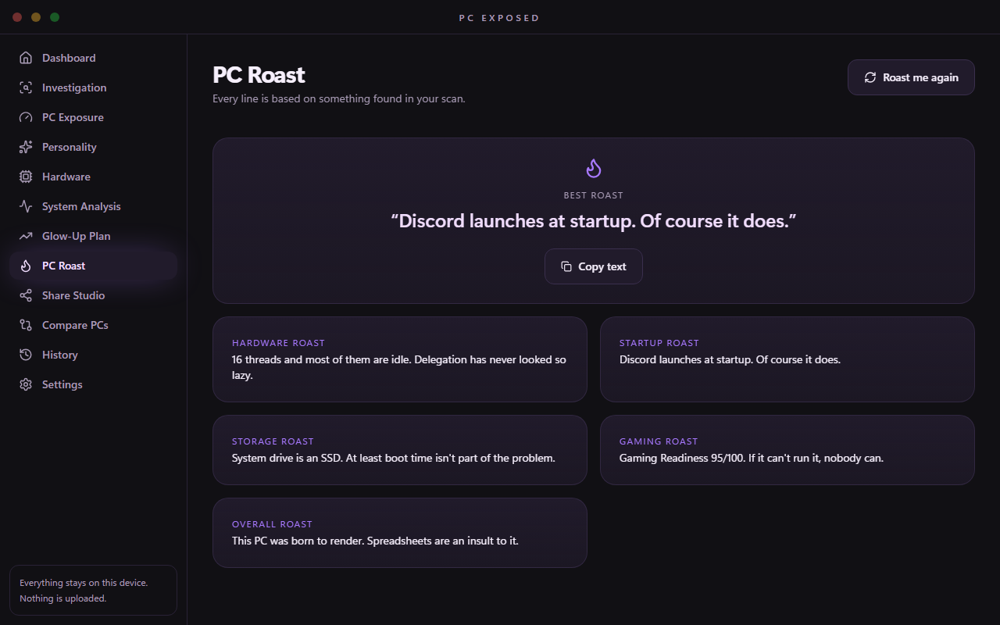
</p>
<p>
  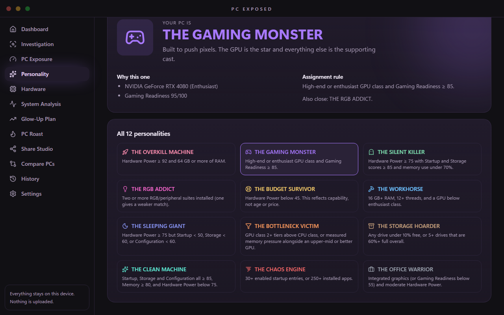
  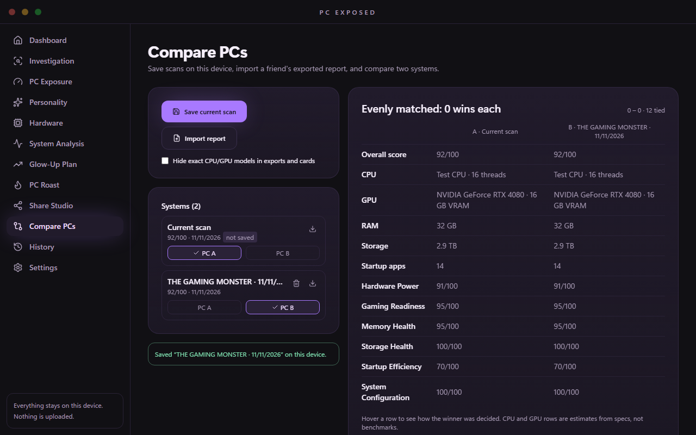
</p>

### Share cards

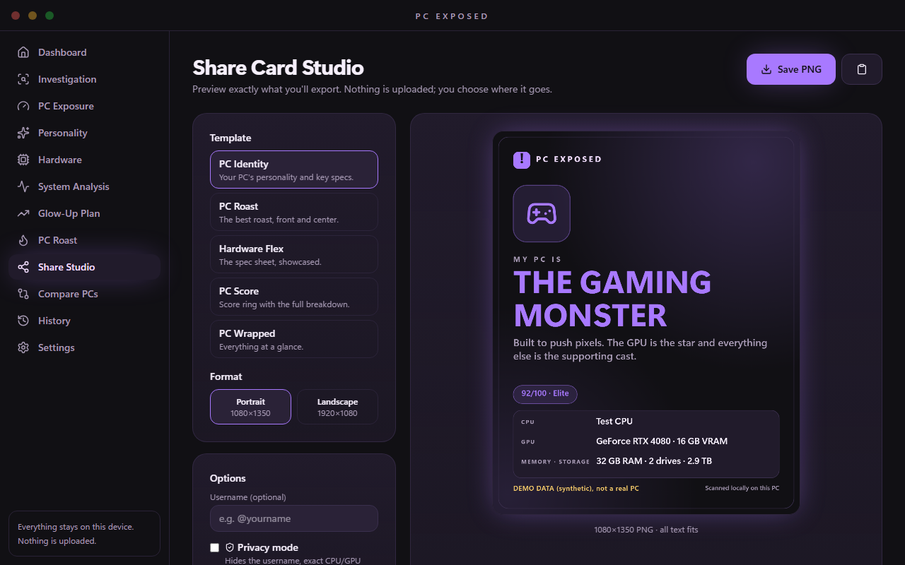

<p>
  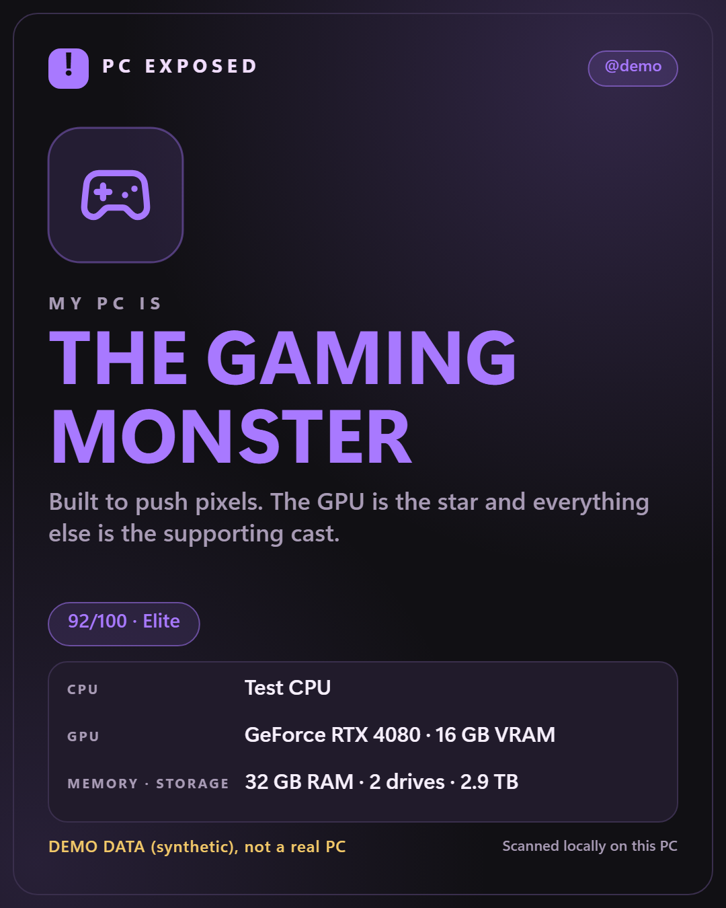
  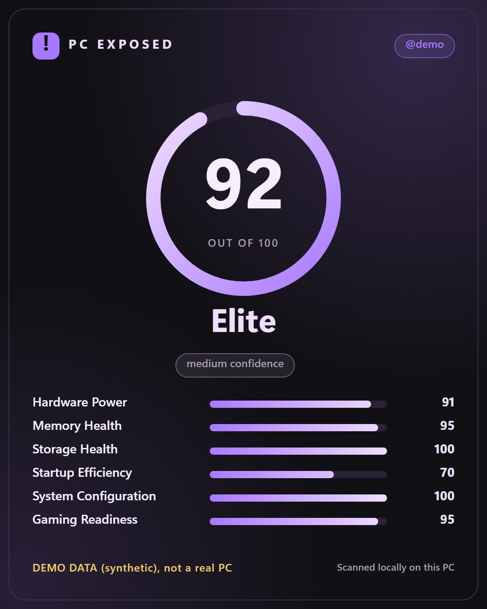
  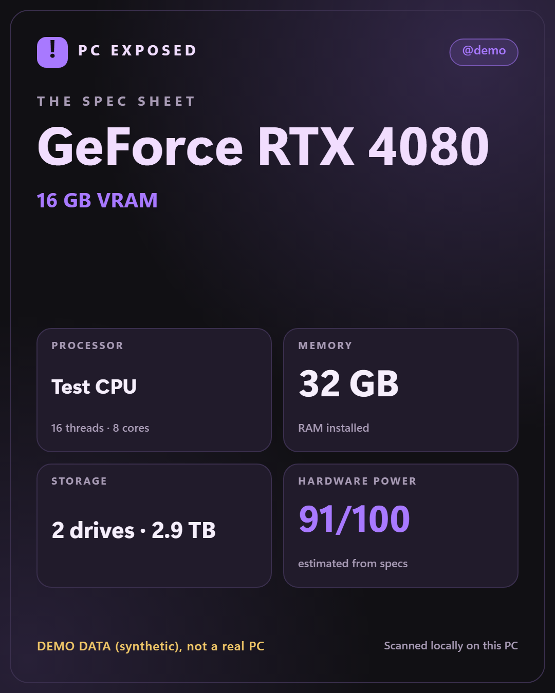
</p>
<p>
  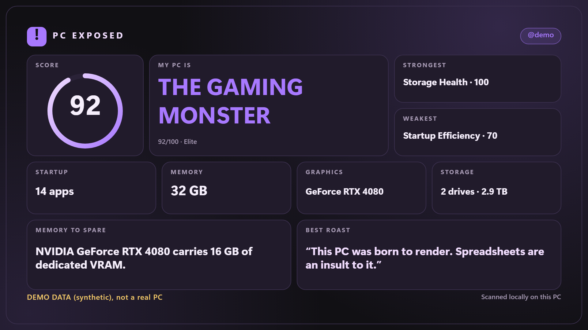
  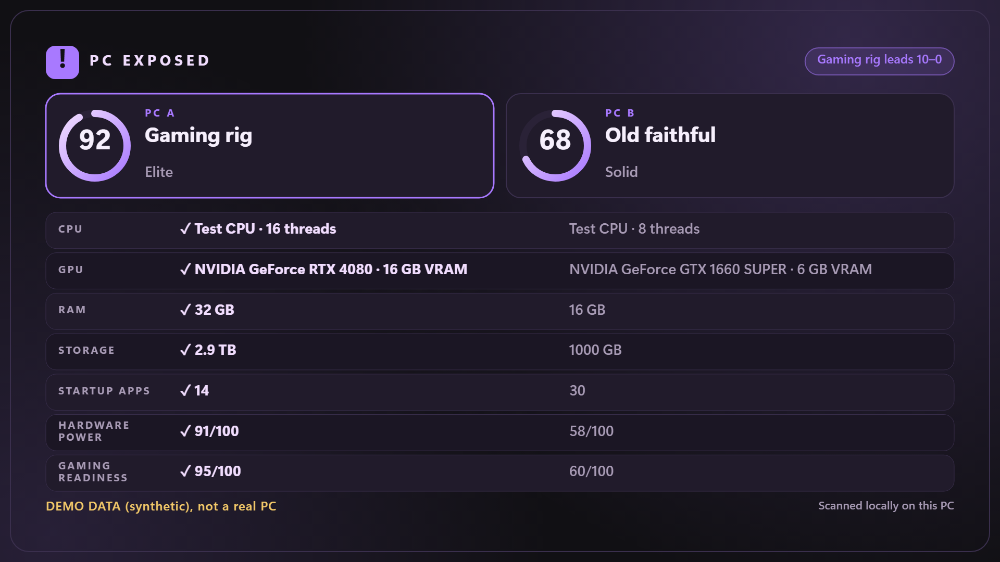
</p>

## Privacy first

- **No account, telemetry, analytics, crash reporting or automatic updates.**
- The app contains **no network-request code**, and its Content Security Policy blocks every external connection.
- The interface can do nothing but move and close the window. Saving a file goes through a validated native
  command, and **you** pick where it is written.
- Imported report files are treated as hostile: validated against a whitelist, size- and range-limited, never executed.
- Scan history is **off by default**; when on, it keeps only the report summary (no app or process names).
- Delete everything it stores in **Settings → Local data**.

Read exactly what a scan reads (and never reads) in [docs/PRIVACY.md](docs/PRIVACY.md), and the evidence behind
these claims in [docs/SECURITY_REVIEW.md](docs/SECURITY_REVIEW.md).

## Install

**Requirements:** Windows 10 or 11, x64. The Microsoft WebView2 runtime (preinstalled on Windows 11; the
installer fetches it on Windows 10 if missing).

1. Download the installer (`PC.EXPOSED_<version>_x64-setup.exe`; GitHub shows spaces as dots) from this repository's **Releases** page.
2. Optionally verify it against `SHA256SUMS.txt`:
   `Get-FileHash .\PC*setup.exe -Algorithm SHA256`
3. Run it. It installs **per-user and needs no administrator rights** (to `%LOCALAPPDATA%\PC EXPOSED`), and adds
   Start menu and desktop shortcuts. Uninstall it from *Settings → Apps*. Your saved data is kept; remove it with
   *Settings → Local data → Reset all local data* inside the app first (see [docs/PRIVACY.md](docs/PRIVACY.md)).

> **Installers are not code-signed yet.** Windows SmartScreen may show "Windows protected your PC".
> Only download from this repository's Releases page. Code signing is planned.

## Build from source

Prerequisites: Node 22+, Rust (stable, MSVC toolchain), Visual Studio Build Tools with the **C++ workload**,
and WebView2.

```powershell
git clone <repository-url>
cd pc-exposed
npm ci

npm run tauri dev        # desktop app with hot reload
npm run tauri build      # optimized app + installer in src-tauri/target/release/
```

The browser-only preview (`npm run dev`, then add `?demo=1` to the URL, or `?demo=budget` for a struggling
laptop) loads clearly labelled synthetic data; real scans need the desktop app. Regenerate the README
screenshots and the per-release gallery in `docs/screenshots/updates/` with `$env:SCREENSHOTS=1; npm run screenshots`.

### Tests

```powershell
npm run typecheck
npm test                 # unit tests (Vitest)
npm run test:e2e         # UI tests: Playwright + axe accessibility audit + share-card rendering audit
cd src-tauri
cargo fmt --check; cargo clippy --all-targets -- -D warnings
cargo test               # includes a real scan of your machine
```

## How it works

A small **Rust** core collects (WMI, DXGI, the registry, Win32 APIs). A **TypeScript** engine analyzes, with
no dependency on React, and a **React** UI presents. Share cards are drawn on a Canvas and audited for
clipping, truncation and overlap. See [docs/ARCHITECTURE.md](docs/ARCHITECTURE.md).

- Report file format: [docs/report-format.md](docs/report-format.md)
- Localization (English now, Arabic/RTL-ready): [docs/localization.md](docs/localization.md)
- Accessibility (WCAG 2.1 AA, automated audit): [docs/ACCESSIBILITY.md](docs/ACCESSIBILITY.md)

## Known limitations

- **GPU utilization and temperature are not read** (they need vendor APIs); they show as *Unavailable*.
- GPU performance class is **estimated from the model name**, not benchmarked, and is labelled as an estimate.
  New GPU models are shown as "not recognized" until added.
- Storage Health reflects free space and drive type. **SMART/wear data is not read.**
- Only English ships. Some screens and all roast/analysis text are English-only
  (see [localization status](docs/localization.md#what-is-not-yet-localized-honest-status)).
- Laptops, HDD systems and Windows 10 are covered by tests and fixtures but have had little real-hardware testing:
  please [open an issue](../../issues/new/choose) if a reading looks wrong.
- Not yet tested with a real screen reader (NVDA/Narrator) or Windows High Contrast mode.
- Glow-Up Plan projections show how the *score* would move, not frame rates or boot times. The Windows 11
  suggestion does not check eligibility.
- No MSI installer yet (the format rejects pre-release versions); the NSIS installer is provided.

## Contributing

Bug reports, hardware feedback, roast lines and code are welcome: see [CONTRIBUTING.md](CONTRIBUTING.md).
Security issues: see [SECURITY.md](SECURITY.md). Release process: [docs/RELEASING.md](docs/RELEASING.md).

## License

[MIT](LICENSE). Third-party licenses: [THIRD_PARTY_LICENSES.md](THIRD_PARTY_LICENSES.md).
