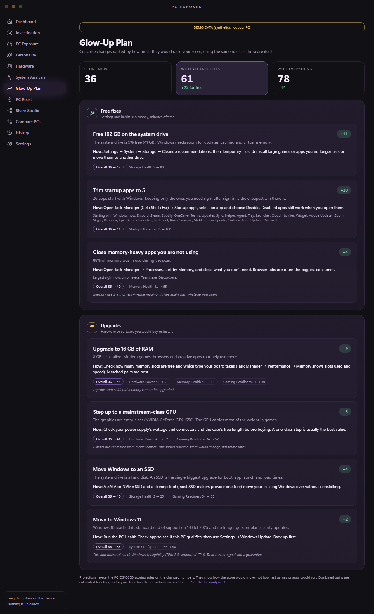
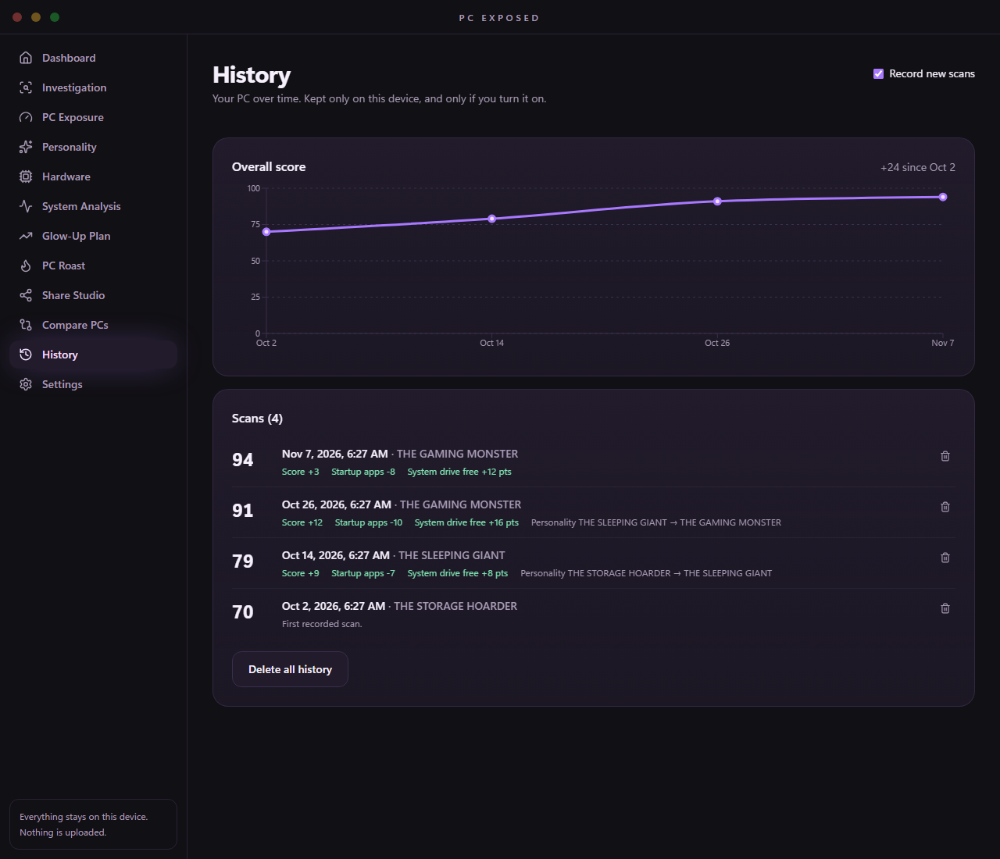

# PC EXPOSED v0.2.0-beta.1

**From "here's what's wrong" to "here's what to do about it."**

v0.1 told you your PC's score, personality and sins. v0.2 tells you which changes would actually raise that
score and by how much, and (if you turn it on) shows whether they worked.



*All screenshots use clearly labelled synthetic demo data, not a real machine.*

## What's new

### Glow-Up Plan

A new screen that ranks concrete changes by how many points they would add to your score:

- **Free fixes:** trim startup apps (it lists the ones it found), free a specific amount of space on the
  system drive, restart after weeks of uptime, close memory-heavy apps, uninstall apps you don't use.
- **Upgrades:** the next RAM size, moving Windows to an SSD, Windows 11, a GPU one class up.

Every card shows the projected overall score, which categories move (e.g. *Startup Efficiency 30 → 100*),
how to do it in plain steps, and its limits. The header shows where *all free fixes together* and
*everything together* would land you.

**Why you can trust the numbers:** a projection isn't a separate set of guesses. It takes your measured
numbers, changes one thing (say, 26 startup apps → 5) and runs the **same scoring rules** again. Projections
show how the score would move, not frame rates or boot times, and the app says so.

Open it from the sidebar, from the Dashboard, or from the hint on **PC Exposure**.

### Scan history (opt-in)

Turn it on from the Dashboard, the History screen or *Settings → Local data*. Each real scan is then kept
as a small summary (the same summary as an exported report: hardware classes and scores, **no app, process
or startup-app names**), up to 60.

- A score-over-time chart, and per-scan changes in score, startup apps, free space, RAM, installed apps and personality.
- The Dashboard shows *"Up 6 since your scan on 2 Oct"* and, after you restart the app, your last recorded scan.
- Delete a single scan, all history, or everything the app stores.

It is **off by default**, so v0.1's promise holds: nothing about a scan is stored until you choose.



### Copy specs

**Hardware → Copy specs** puts a plain-text spec sheet on your clipboard, ready for a forum post or a
"what should I upgrade?" thread. [Example](../screenshots/updates/v0.2.0-beta.1/spec-sheet-example.txt):

```
CPU: Test CPU (8C/16T, 4.00 GHz)
GPU: NVIDIA GeForce RTX 4080 (16 GB)
RAM: 32 GB
Storage: C: 1000 GB SSD (42% free), D: 2.0 TB SSD (45% free)
OS: Windows 11 Pro 24H2 (build 26100.1)
Form factor: desktop (no battery)
```

### A real icon

The placeholder "!" is replaced by the PC EXPOSED eye.

## Fixes

- Exported reports always said `appVersion: 0.1.0-beta.1`; the version is now injected from the build.
- Saved reports are dated by when the scan ran, and the same scan can't be saved twice.
- Laptop integrated GPUs like **Radeon 890M / 780M** and **Intel Arc 140V / 130T** are now recognized, so
  those PCs get Hardware Power and Gaming Readiness scores instead of "not recognized".
- PC Wrapped no longer double-advances when you press Space on a button.
- Compare PCs: a rejected import can be retried with the same file.
- Share Studio: fast template switching can no longer leave a stale card in the preview.
- The installed app ignores F5/Ctrl+R (which threw away your scan) and the browser right-click menu.
- No more stray focus box around screen titles.

## Upgrading

Install over v0.1.0-beta.1. Saved reports, settings and card preferences are kept, and the report file
format is unchanged (still version 1), so reports exported by either version import into the other.

## Verify your download

Download `PC.EXPOSED_0.2.0-beta.1_x64-setup.exe` and `SHA256SUMS.txt`, then:

```powershell
Get-FileHash .\PC.EXPOSED_0.2.0-beta.1_x64-setup.exe -Algorithm SHA256
```

The installer is per-user (no administrator rights) and **not code-signed yet**, so SmartScreen may warn.

## Known limitations

- Glow-Up Plan projections are score projections, not performance predictions. The Windows 11 suggestion
  does not check eligibility (TPM 2.0, supported CPU).
- GPU utilization/temperature and SMART drive health are still not read.
- English only; Windows 10/11 x64 only; installers unsigned; no MSI for pre-releases.

Full list of changes: `CHANGELOG.md`.
